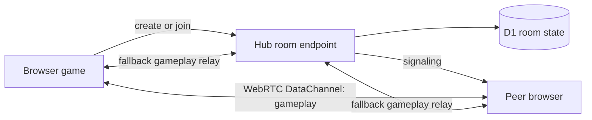

# Stickfigure Mayhem architecture

The [JRod architecture dashboard](https://jrod.download/architecture/#game-flow-stickfigure-mayhem-content) maps the Hub integration. The currently recorded Hub game export is pinned to [5d1584c7](https://github.com/jrodthewiz/dualsstickfigure/tree/5d1584c7f09fdf8a07697698e27dea8169828b37).

The Hub Worker serves the Next.js export and implements the room endpoint. The room service handles membership and signaling. Browsers use WebRTC DataChannels for gameplay when connected; the same room endpoint relays gameplay while the direct connection is pending or unavailable. A public STUN service assists address discovery. No provider key or TURN service is required for the relay path. Voice uses a separate WebRTC stream and can be unavailable where direct connectivity is blocked. Solo bot fights run locally in the browser. Rooms expire after the host disconnects.

For setup, deployment, and verification commands, see [README.md](README.md). The pinned source revision records the Hub integration; a GitHub commit alone does not deploy the Hub.
